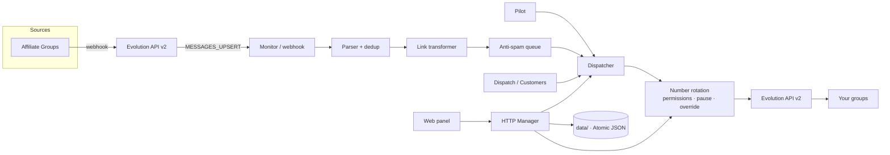

# Alcance

[](https://github.com/Regimarcilio/alcance-promo-radar/actions/workflows/ci.yml)
[](https://github.com/Regimarcilio/alcance-promo-radar/releases)
[](https://nodejs.org/)
[](https://www.typescriptlang.org/)
[](#license)

**Monitor and offer dispatcher for WhatsApp.** Alcance reads offers from affiliate groups,
identifies the product (Mercado Livre, Amazon and Shopee), swaps the affiliate link for your
affiliate link and forwards to your groups — with anti-spam queue, deduplication, number rotation
and an authenticated web panel.

> Legacy technical name of the package: `automensagemwhats`. The product and interface use the
> **Alcance** brand.

---

## Table of Contents

- [Overview](#overview)
- [Features](#features)
- [Architecture](#architecture)
- [Stack](#stack)
- [Requirements](#requirements)
- [Quick Installation](#quick-installation)
- [Docker](#docker)
- [Configuration](#configuration)
- [Multi-number](#multi-number)
- [Using the Panel](#using-the-panel)
- [Quality and Tests](#quality-and-tests)
- [Project Structure](#project-structure)
- [Security](#security)
- [Observability](#observability)
- [Documentation](#documentation)
- [Known Issues](#known-issues)
- [License](#license)

---

## Overview

The workflow is simple and auditable:

1. an affiliate group publishes an offer;
2. the **Evolution API v2** webhook delivers the message to Alcance;
3. the **parser** identifies product, price, coupon and link;
4. the **transformer** swaps the link for your affiliate link;
5. the **anti-spam queue** controls the pace;
6. the **dispatcher** chooses a healthy number and sends to the destination group.

In addition to the Monitor, the panel offers **Automatic Pilot** (searches and publishes offers
with its own account), **Customer Dispatches** (lists and campaigns with media), **Tracking** of
everything published and **number management** with permissions and pause.

## Features

| Area | What it does |
|---|---|
| **Monitor** | Webhook → parser → atomic dedup → link transformation → Emipe template → send with anti-spam queue. |
| **Pilot** | Searches offers by category/keyword and automatically publishes on Mercado Livre and Amazon. |
| **Dispatch (Customers)** | Syncs group participants, maintains lists, manual registration and campaigns with image/video and link. |
| **Multi-program** | Mercado Livre (`meli.la`), Amazon (`amzn.to`/ASIN) and Shopee (`shope.ee` via Open API). |
| **Multi-number** | Up to 5 numbers, weighted rotation (weight 1–10), anti-repetition, flow permissions and individual pause. |
| **Accounts & Links** | Affiliate labels, category → account/group mapping and default groups. |
| **Coupons** | Mercado Livre coupons applied to the message. |
| **Tracking** | Publication history with exact links, total counter and CSV export. |
| **Messaging** | Internal broker layer: versioned envelope, **real ACK**, retry with backoff, **DLQ**, idempotency and event topics. |
| **Security** | Session-based login, 2FA via WhatsApp on first access, rate-limit, audit and restrictive headers. |
| **Observability** | `/healthz`, `/readyz`, structured logs and Prometheus metrics at `/metrics`. |

## Architecture



**Persistence:** the project **does not use SQLite** or its own database. All operational state lives in
atomic JSON files in `data/` (e.g. `auth-users.json`, `clientes.json`, `instancias.json`,
`monitor.json`, `monitor-fila.json`, `envios.json`, `publicacoes.json`, `rastreio-total.json`).
The Postgres in `docker-compose.yml` belongs **only to Evolution API v2**.

## Stack

- **Node.js ≥ 20** with **TypeScript ESM**
- **Evolution API v2** (Baileys) for WhatsApp
- **Docker Compose** (manager + Evolution + Postgres)
- **Prometheus + Grafana** (optional)
- Persistência em **JSON atômico** (`data/`)

## Requirements

- Node.js 20+ and npm 10+
- An Evolution API v2 instance accessible (`EVO_URL`/`EVO_KEY`)
- A WhatsApp number paired in Evolution
- (Optional) Docker and Docker Compose for the full stack

## Quick Installation

```bash
git clone https://github.com/Regimarcilio/alcance-promo-radar.git
cd alcance-promo-radar

npm ci
cp .env.example .env          # fill in EVO_KEY, SESSION_SECRET, WEBHOOK_KEY etc.

npm run auth:user -- admin --telefone 5511999999999
npm run build
npm run manager               # http://localhost:8091
```

The `auth:user` command **requires the phone with DDI** (`--telefone`), creates credentials in
`data/auth-users.json` with mode `0600` and, on first login, sends a 10-character alphanumeric
code via WhatsApp (valid for 10 minutes).

> The Evolution instance must be up to send the verification code. In a TTY-less environment (CI),
> use `AUTH_PASSWORD='...' npm run auth:user -- admin --telefone 5511999999999`.

Development with reload:

```bash
npm run manager:dev
```

## Docker

**Full stack (recommended to start from scratch).** `docker-compose.yml` builds the manager image
from `Dockerfile.manager` and starts Evolution v2 + Postgres:

```bash
docker compose up -d --build
# panel at http://127.0.0.1:${MANAGER_PORT:-8091}/login
```

The port is published on **loopback by default** (`${MANAGER_BIND:-127.0.0.1}`). To expose on
LAN/WAN, use TLS/reverse proxy and only then `MANAGER_BIND=0.0.0.0`. In local HTTP, also adjust
`AUTH_COOKIE_SECURE=0`; in production the cookie requires HTTPS.

**Manager only, using an existing Evolution network.** `docker-compose.manager-novo.yml` has no
`build:` and uses the ready image `promo-radar-manager:latest`:

```bash
docker build -f Dockerfile.manager -t promo-radar-manager:latest .
docker compose -f docker-compose.manager-novo.yml up -d
# panel at http://127.0.0.1:${MANAGER_PORT_NOVO:-8099}
```

> The container runs the `dist/` baked into the image. Code changes require
> `docker compose build` + container recreation — `docker restart` does **not** apply new code.

## Configuration

The full template is in [`.env.example`](.env.example). Essential variables:

| Variable | Purpose |
|---|---|
| `EVO_URL`, `EVO_KEY`, `EVO_INSTANCE` | Connection to Evolution API |
| `WEBHOOK_KEY` | Authenticates the webhook (`X-Webhook-Key`, min 16 chars) |
| `SESSION_SECRET` | Signs the panel session (min 32 chars) |
| `AUTH_TTL_HORAS`, `AUTH_IDLE_MIN` | Absolute validity and inactivity timeout of the session |
| `MANAGER_BIND`, `MANAGER_PORT` | Panel address/port (default `127.0.0.1:8091`) |
| `MANAGER_KEY` | Optional machine credential for `/api/*` |
| `JANELA_INICIO`, `JANELA_FIM` | Sending window (default `08:00`–`23:00`) |
| `CLIENTES_INTERVALO_S` | Campaign send interval (default `60`) |
| `RODIZIO_EVITA_REPETICAO` | Probability to not repeat the previous number (default `0.7`) |
| `RASTREIO_LIMITE` | Tracking storage ceiling (default `50000`, floor `1000`) |
| `AMAZON_TAG`, `AMAZON_CREATORS_ID`, `AMAZON_CREATORS_SECRET` | Amazon |
| `SHOPEE_APP_ID`, `SHOPEE_APP_SECRET`, `SHOPEE_SUB_IDS` | Short affiliate link for Shopee |
| `TAG_ML`, `COOKIE_ML`, `ML_ACCESS_TOKEN` | Mercado Livre enrichment and favorites |

## Multi-number

Sending is distributed among registered numbers, reducing block risk:

- **Up to 5 numbers**, with **weight** (1–10) defining each one's share in rotation.
- **Per-number permissions**: a number only participates in flows **Pilot**, **Monitor** and/or
  **Dispatch** if the corresponding permission is enabled.
- **Pause/Resume**: pauses the number **entirely** (all flows) without removing it from the registry.
- **Principal**: preferred for service operations (adding contacts, group permissions).
- **Manual override**: optionally fix a specific number per flow; if it becomes invalid (paused, no
  permission or disconnected), the system returns to automatic and logs a warning.
- **Per-campaign**: in the Customers panel, each campaign can lock the number that sends its messages;
  if the fixed number drops, sending returns to rotation with a warning.
- **Protections**: business hours, time variation, anti-repetition and discarding "zombie" instances
  that respond `open` but fail on send.
- **Per campaign**: in the Customers panel, each campaign can fix the number that sends its messages; if that number drops, sending returns to rotation with warning.

## Messaging

Internal communication layer between applications (producer → broker → consumer), with broker
semantics — see the [ADR-011](docs/04-ADRs/ADR-011-mensageria.md).

- **Standardized envelope**: `id`, `tipo`, `versao`, `timestamp`, `correlationId`, `chave`, `payload`.
- **Real ACK**: the message leaves the queue **only after** processed — failure does not lose send.
- **Retry with exponential backoff and jitter** (transient errors only) and **Dead Letter Queue** for
  the permanently failed ones, with the reason logged.
- **Idempotency** by business key (`${disparoId}:${jid}`), so redelivery does not duplicate message.
- **Topics (Pub/Sub)**: events like `oferta.recebida`, `disparo.criado`, `instancia.desconectada`,
  with per-subscriber queues.
- **Tracking**: `correlationId` traverses the flow (webhook → queue → send → event) and appears in
  structured logs.
- **Replaceable broker**: the current adapter is file-based (`data/messaging/`); the interface allows
  switching to RabbitMQ/Kafka without touching producers and consumers.
- **Duplicate resend (24h)**: the duplicate (business key already processed) **is no longer discarded** —
  it goes back to the queue, scheduled for **24 hours after the original launch**, and goes through
  the messaging rate (anti-spam interval, business hours, ACK/retry/DLQ). There is no direct send,
  and the resend is **unique** (if it fails, it follows normal retry/DLQ).
  Switches: `MENSAGERIA_REENVIO_DUP_ATIVO` (1 = on), `MENSAGERIA_REENVIO_DUP_HORAS` (24) and
  `MENSAGERIA_REENVIO_DUP_TIPOS` (types with resend; `*` = all). With switch off, duplicate goes
  back to discard.

  > ⚠️ **Monitor attention**: the Monitor's business key is the **offer hash**
  > (`mlbId|preco|cupom`, same as Pilot). Therefore **the same offer sent before is
  > forwarded again 24h later** — accepted risk by operator on 12/11/2026. To disable just the
  > Monitor: `MENSAGERIA_REENVIO_DUP_TIPOS=cliente.enviar`. The panel shows the
  > source of the resend (badge **↻ reenvio 24h**) in the DLQ table and the events table.
  > Details in [ADR-011](docs/04-ADRs/ADR-011-mensageria.md).

APIs: `GET /api/mensageria/stats`, `GET /api/mensageria/filas`, `GET /api/mensageria/dlq`,
`GET /api/mensageria/eventos` and `POST /api/mensageria/dlq/reprocessar`.

## Using the Panel

The panel groups flows in tabs: **Pilot**, **Monitor**, **Clients**, **Accounts**, **Coupons**,
**Numbers** and **Tracking**, with six themes.

- **Pilot**: enable/disable loops and watch automatic publications.
- **Monitor**: configure sources, destinations, rules and the anti-spam queue.
- **Clients**: sync participants, build lists and dispatch campaigns.
- **Numbers**: add phones by QR, set permissions, weight and pause.
- **Tracking**: see what was published (Pilot + Monitor), with exact link and CSV export.

## Quality and Tests

```bash
npm run typecheck        # tsc --noEmit
npm run build            # compiles to dist/
npm test                 # 273 tests (node:test)
npm run test:coverage    # experimental coverage from node:test
npm run smoke:manager    # starts manager with temp state and validates the health gate
```

The CI (`.github/workflows/ci.yml`) runs **typecheck, build, tests and manager smoke** on every
push/PR to `develop` and `main`.

## Project Structure

```
src/manager/    HTTP panel, authentication, login and API routes
src/messaging/  messaging layer: envelope, broker, DLQ, idempotency, topics
src/monitor/    webhook, parser, transformation, queue, dedup and state
src/wa/         dispatch, Evolution provider and number rotation
src/clientes/   contacts, lists and campaign dispatch
src/ml/         Mercado Livre offers engine
src/hunter/     search by category/keyword
src/jobs/       automatic execution
src/store/      atomic JSON persistence (publications, dedup)
docs/           SRS, architecture, ADRs, backlog, prototypes and dev-log
scripts/        automation (auth, smoke, backup)
```

## Security

- Credentials never go to the repository: `.env`, `data/` and `logs/` are ignored.
- Panel password is in `data/auth-users.json` (mode `0600`), created by `npm run auth:user`.
- Webhook requires `WEBHOOK_KEY`; panel requires session (or `MANAGER_KEY` for machine access).
- **Default-deny gate**, rate-limit, audit with truncated IP and phone verification on 1st access.
- **Do not expose on LAN/WAN without TLS.** Use Caddy (`Caddyfile`) or equivalent reverse proxy.
- Details and checklist in [`SECURITY.md`](SECURITY.md) and [`docs/13-auth-spec.md`](docs/13-auth-spec.md).

## Observability

The manager exposes Prometheus-style metrics at `/metrics`:

| Metric | Type | Description |
|---|---|---|
| `alcance_up` | gauge | System online (1/0) |
| `alcance_monitor_recebidas_total` | counter | Messages received |
| `alcance_monitor_encaminhadas_total` | counter | Messages forwarded |
| `alcance_monitor_duplicadas_total` | counter | Duplicate messages |
| `alcance_monitor_erros_total` | counter | Messages with error |
| `alcance_fila_tamanho` | gauge | Items in queue |
| `alcance_instancias_ativas_total` | gauge | Active instances |
| `alcance_disparos_total` | counter | Campaigns created |
| `alcance_janela_aberta` | gauge | Sending window open |

Optional stack with Prometheus + Grafana:

```bash
docker compose -f docker-compose.yml -f docker-compose.monitoring.yml up -d --build
# Grafana at http://127.0.0.1:3000 (credentials in .env)
```

## Documentation

- [`docs/00-INDICE.md`](docs/00-INDICE.md) — entry point: what's current, historical or planned.
- [`docs/SRS-v0.4.md`](docs/SRS-v0.4.md) — current requirements with traceability RF → code → test.
- [`docs/SRS-v0.4-delta-mensageria.md`](docs/SRS-v0.4-delta-mensageria.md) — messaging layer delta (RF-057 to RF-061).
- [`docs/03-arquitetura-e-uml.md`](docs/03-arquitetura-e-uml.md) — architecture and diagrams.
- [`docs/04-ADRs/`](docs/04-ADRs/) — architecture decisions (ADR-001 to ADR-011).
- [`docs/prototipos/mensageria/`](docs/prototipos/mensageria/) — navigable prototype of the Messaging screen (queues, DLQ and Reprocess).
- [`docs/13-auth-spec.md`](docs/13-auth-spec.md) — authentication and security checklist.
- [`docs/dev-log.md`](docs/dev-log.md) — dev-log with evidence per delivery.
- [`CHANGELOG.md`](CHANGELOG.md) — release notes (Keep a Changelog + SemVer).

## Known Issues

- **Shopee credentials** depend on affiliate program approval.
- **AI Gateway** is still a deterministic stub (zero cost); paid models not connected.
- **Temporary messages** (ephemeral) of 7 days in destination are not resent as temporaries.
- Dependency `zod` with pre-existing security warning; fix requires major version 4.x.

## License

Project is **proprietary**. All rights reserved. Consult the project owner before
redistributing, publishing or reusing the code.