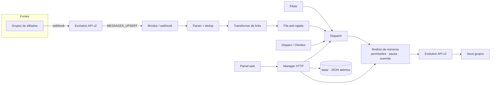

# Alcance

[](https://github.com/Regimarcilio/alcance-promo-radar/actions/workflows/ci.yml)
[](https://github.com/Regimarcilio/alcance-promo-radar/releases)
[](https://nodejs.org/)
[](https://www.typescriptlang.org/)
[](#licença)

**Monitor e disparador de ofertas para WhatsApp.** O Alcance lê ofertas de grupos de afiliados,
identifica o produto (Mercado Livre, Amazon e Shopee), troca o link pelo seu link de afiliado e
reencaminha para os seus grupos — com fila anti-rajada, deduplicação, rotação de números e um
painel web autenticado.

> Nome técnico legado do pacote: `automensagemwhats`. O produto e a interface usam a marca **Alcance**.

---

## Sumário

- [Visão geral](#visão-geral)
- [Funcionalidades](#funcionalidades)
- [Arquitetura](#arquitetura)
- [Stack](#stack)
- [Requisitos](#requisitos)
- [Instalação rápida](#instalação-rápida)
- [Docker](#docker)
- [Configuração](#configuração)
- [Multi-número](#multi-número)
- [Usando o painel](#usando-o-painel)
- [Qualidade e testes](#qualidade-e-testes)
- [Estrutura do projeto](#estrutura-do-projeto)
- [Segurança](#segurança)
- [Observabilidade](#observabilidade)
- [Documentação](#documentação)
- [Pendências conhecidas](#pendências-conhecidas)
- [Licença](#licença)

---

## Visão geral

O fluxo é simples e auditável:

1. um grupo de afiliados publica uma oferta;
2. o webhook da **Evolution API v2** entrega a mensagem ao Alcance;
3. o **parser** identifica produto, preço, cupom e link;
4. o **transformer** troca o link pelo seu link de afiliado;
5. a **fila anti-rajada** controla o ritmo;
6. o **dispatch** escolhe um número saudável e envia ao grupo de destino.

Além do monitor, o painel oferece **Piloto automático** (busca e publica ofertas por conta própria),
**Disparo para clientes** (listas e campanhas com mídia), **Rastreio** de tudo que foi publicado e
**gestão de números** com permissões e pausa.

## Funcionalidades

| Área | O que faz |
|---|---|
| **Monitor** | Webhook → parser → dedup atômico → transformação de link → template Emipe → envio com fila anti-rajada. |
| **Piloto** | Busca ofertas por categoria/palavra-chave e publica automaticamente no Mercado Livre e na Amazon. |
| **Disparo (Clientes)** | Sincroniza participantes dos grupos, mantém listas, cadastro manual e campanhas com imagem/vídeo e link. |
| **Multi-programa** | Mercado Livre (`meli.la`), Amazon (`amzn.to`/ASIN) e Shopee (`shope.ee` via Open API). |
| **Multi-número** | Até 5 números, rodízio ponderado (peso 1–10), anti-repetição, permissões por fluxo e pausa individual. |
| **Contas & vínculos** | Etiquetas de afiliado, mapa categoria → conta/grupo e grupos padrão. |
| **Cupons** | Cupons do Mercado Livre aplicados à mensagem. |
| **Rastreio** | Histórico de publicações com o link exato publicado, contador total real e exportação CSV. |
| **Segurança** | Login com sessão, 2FA por WhatsApp no 1º acesso, rate-limit, auditoria e headers restritivos. |
| **Observabilidade** | `/healthz`, `/readyz`, logs estruturados e métricas Prometheus em `/metrics`. |

## Arquitetura



**Persistência:** o projeto **não usa SQLite** nem banco próprio. Todo o estado operacional fica em
arquivos JSON atômicos em `data/` (ex.: `auth-users.json`, `clientes.json`, `instancias.json`,
`monitor.json`, `monitor-fila.json`, `envios.json`, `publicacoes.json`, `rastreio-total.json`).
O Postgres do `docker-compose.yml` pertence **apenas à Evolution API v2**.

## Stack

- **Node.js ≥ 20** com **TypeScript ESM**
- **Evolution API v2** (Baileys) para WhatsApp
- **Docker Compose** (manager + Evolution + Postgres)
- **Prometheus + Grafana** opcionais
- Persistência em **JSON atômico** (`data/`)

## Requisitos

- Node.js 20+ e npm 10+
- Uma instância da Evolution API v2 acessível (`EVO_URL`/`EVO_KEY`)
- Um número de WhatsApp pareado na Evolution
- (Opcional) Docker e Docker Compose para o stack completo

## Instalação rápida

```bash
git clone https://github.com/Regimarcilio/alcance-promo-radar.git
cd alcance-promo-radar

npm ci
cp .env.example .env          # preencha EVO_KEY, SESSION_SECRET, WEBHOOK_KEY etc.

npm run auth:user -- admin --telefone 5511999999999
npm run build
npm run manager               # http://localhost:8091
```

O `auth:user` **exige o celular com DDI** (`--telefone`), cria a credencial em
`data/auth-users.json` com permissão `0600` e, no primeiro login, envia um código alfanumérico de
10 posições por WhatsApp (validade de 10 minutos).

> A Evolution precisa estar no ar para enviar o código de verificação. Em ambiente sem TTY (CI),
> use `AUTH_PASSWORD='...' npm run auth:user -- admin --telefone 5511999999999`.

Desenvolvimento com recarga:

```bash
npm run manager:dev
```

## Docker

**Stack completa (recomendado para subir do zero).** O `docker-compose.yml` constrói a imagem do
manager a partir de `Dockerfile.manager` e sobe Evolution v2 + Postgres:

```bash
docker compose up -d --build
# painel em http://127.0.0.1:${MANAGER_PORT:-8091}/login
```

A porta é publicada em **loopback por padrão** (`${MANAGER_BIND:-127.0.0.1}`). Para expor em
LAN/WAN, use TLS/reverse proxy e só então `MANAGER_BIND=0.0.0.0`. Em HTTP local, ajuste também
`AUTH_COOKIE_SECURE=0`; em produção o cookie exige HTTPS.

**Somente o manager, em uma rede Evolution existente.** O `docker-compose.manager-novo.yml` não tem
`build:` e consome a imagem pronta `promo-radar-manager:latest`:

```bash
docker build -f Dockerfile.manager -t promo-radar-manager:latest .
docker compose -f docker-compose.manager-novo.yml up -d
# painel em http://127.0.0.1:${MANAGER_PORT_NOVO:-8099}
```

> O container roda o `dist/` embutido na imagem. Alterações de código exigem
> `docker compose build` + recriação do container — `docker restart` não aplica código novo.

## Configuração

O template completo está em [`.env.example`](.env.example). Variáveis essenciais:

| Variável | Para que serve |
|---|---|
| `EVO_URL`, `EVO_KEY`, `EVO_INSTANCE` | Conexão com a Evolution API |
| `WEBHOOK_KEY` | Autentica o webhook (`X-Webhook-Key`, mínimo 16 chars) |
| `SESSION_SECRET` | Assina a sessão do painel (mínimo 32 chars) |
| `AUTH_TTL_HORAS`, `AUTH_IDLE_MIN` | Validade absoluta e por inatividade da sessão |
| `MANAGER_BIND`, `MANAGER_PORT` | Endereço/porta do painel (default `127.0.0.1:8091`) |
| `MANAGER_KEY` | Credencial machine opcional para `/api/*` |
| `JANELA_INICIO`, `JANELA_FIM` | Janela de envio (default `08:00`–`23:00`) |
| `CLIENTES_INTERVALO_S` | Intervalo entre envios de campanha (default `60`) |
| `RODIZIO_EVITA_REPETICAO` | Probabilidade de não repetir o número anterior (default `0.7`) |
| `RASTREIO_LIMITE` | Teto de armazenamento do Rastreio (default `50000`, piso `1000`) |
| `AMAZON_TAG`, `AMAZON_CREATORS_ID`, `AMAZON_CREATORS_SECRET` | Amazon |
| `SHOPEE_APP_ID`, `SHOPEE_APP_SECRET`, `SHOPEE_SUB_IDS` | Link curto de afiliado Shopee |
| `TAG_ML`, `COOKIE_ML`, `ML_ACCESS_TOKEN` | Enriquecimento e favoritos do Mercado Livre |

## Multi-número

O envio é distribuído entre os números cadastrados, reduzindo o risco de bloqueio:

- **Até 5 números**, com **peso** (1–10) definindo a fatia de cada um no rodízio.
- **Permissões por número**: um número só participa dos fluxos **Piloto**, **Monitor** e/ou
  **Disparo** se a permissão correspondente estiver ligada.
- **Pausar/Continuar**: pausa o número **inteiro** (todos os fluxos) sem removê-lo do cadastro.
- **Principal**: preferido para operações de serviço (adicionar contatos, permissões de grupo).
- **Override manual**: opcionalmente, fixe um número específico por fluxo; se ele ficar inválido
  (pausado, sem permissão ou desconectado), o sistema volta ao automático e registra aviso.
- **Proteções**: janela comercial, variação de tempo, anti-repetição e descarte de instâncias
  "zumbis" que respondem `open` mas falham no envio.

## Usando o painel

O painel reúne os fluxos em abas: **Piloto**, **Monitor**, **Clientes**, **Contas**, **Cupons**,
**Números** e **Rastreio**, com seis temas.

- **Piloto**: ligue/desligue os loops e acompanhe as publicações automáticas.
- **Monitor**: configure origens, destinos, regras e a fila anti-rajada.
- **Clientes**: sincronize participantes, monte listas e dispare campanhas.
- **Números**: adicione celulares por QR, defina permissões, peso e pausa.
- **Rastreio**: veja o que foi publicado (Piloto + Monitor), com o link exato e exportação CSV.

## Qualidade e testes

```bash
npm run typecheck        # tsc --noEmit
npm run build            # compila para dist/
npm test                 # 207 testes (node:test)
npm run test:coverage    # cobertura experimental do node:test
npm run smoke:manager    # sobe o manager com estado temporário e valida o gate
```

O CI (`.github/workflows/ci.yml`) roda **typecheck, build, testes e smoke do manager** em todo
push/PR para `develop` e `main`.

## Estrutura do projeto

```
src/manager/    painel HTTP, autenticação, login e rotas da API
src/monitor/    webhook, parser, transformação, fila, dedup e estado
src/wa/         dispatch, providers Evolution e rotação de números
src/clientes/   contatos, listas e campanhas de disparo
src/ml/         motor de ofertas Mercado Livre
src/hunter/     busca por categoria/palavra-chave
src/jobs/       execução automática
src/store/      persistência JSON atômica (publicações, dedup)
docs/           SRS, arquitetura, ADRs, backlog, protótipos e diário de bordo
scripts/        automação (auth, smoke, backup)
```

## Segurança

- Credenciais nunca vão para o repositório: `.env`, `data/` e `logs/` são ignorados.
- A senha do painel fica em `data/auth-users.json` (modo `0600`), criada por `npm run auth:user`.
- O webhook exige `WEBHOOK_KEY`; o painel exige sessão (ou `MANAGER_KEY` para machine).
- Gate **default-deny**, rate-limit, auditoria com IP truncado e verificação de celular no 1º acesso.
- **Não exponha em LAN/WAN sem TLS.** Use Caddy (`Caddyfile`) ou reverse proxy equivalente.
- Detalhes e checklist em [`SECURITY.md`](SECURITY.md) e [`docs/13-auth-spec.md`](docs/13-auth-spec.md).

## Observabilidade

O manager expõe métricas no formato Prometheus em `/metrics`:

| Métrica | Tipo | Descrição |
|---|---|---|
| `alcance_up` | gauge | Sistema online (1/0) |
| `alcance_monitor_recebidas_total` | counter | Mensagens recebidas |
| `alcance_monitor_encaminhadas_total` | counter | Mensagens encaminhadas |
| `alcance_monitor_duplicadas_total` | counter | Mensagens duplicadas |
| `alcance_monitor_erros_total` | counter | Mensagens com erro |
| `alcance_fila_tamanho` | gauge | Itens na fila |
| `alcance_instancias_ativas_total` | gauge | Instâncias ativas |
| `alcance_disparos_total` | counter | Campanhas criadas |
| `alcance_janela_aberta` | gauge | Janela de envio aberta |

Stack opcional com Prometheus + Grafana:

```bash
docker compose -f docker-compose.yml -f docker-compose.monitoring.yml up -d --build
# Grafana em http://127.0.0.1:3000 (credenciais no .env)
```

## Documentação

- [`docs/00-INDICE.md`](docs/00-INDICE.md) — porta de entrada: o que é vigente, histórico ou planejado.
- [`docs/SRS-v0.4.md`](docs/SRS-v0.4.md) — requisitos vigentes com rastreabilidade RF → código → teste.
- [`docs/03-arquitetura-e-uml.md`](docs/03-arquitetura-e-uml.md) — arquitetura e diagramas.
- [`docs/04-ADRs/`](docs/04-ADRs/) — decisões arquiteturais (ADR-001 a ADR-010).
- [`docs/13-auth-spec.md`](docs/13-auth-spec.md) — autenticação e checklist de segurança.
- [`docs/dev-log.md`](docs/dev-log.md) — diário de bordo com evidências por entrega.
- [`CHANGELOG.md`](CHANGELOG.md) — release notes (Keep a Changelog + SemVer).

## Pendências conhecidas

- **Credenciais Shopee** dependem de liberação do programa de afiliados.
- **Gateway de IA** ainda é um stub determinístico (custo zero); modelos pagos não foram ligados.
- **Mensagens temporárias** (efêmeras) de 7 dias no destino não são reenviadas como tal.
- Dependência `zod` com aviso de segurança pré-existente; a correção exige a major 4.x.

## Licença

Projeto **proprietário**. Todos os direitos reservados. Consulte o responsável pelo projeto antes de
redistribuir, publicar ou reutilizar o código.
