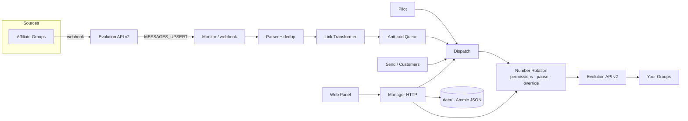
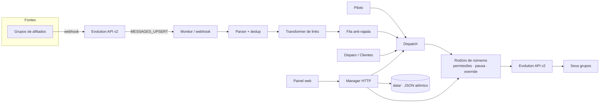

# Alcance

[](https://github.com/Regimarcilio/alcance-promo-radar/actions/workflows/ci.yml)
[](https://github.com/Regimarcilio/alcance-promo-radar/releases)
[](https://nodejs.org/)
[](https://www.typescriptlang.org/)
[](#license)

**WhatsApp offer monitor and sender.** Alcance reads offers from affiliate groups, identifies the product (Mercado Livre, Amazon and Shopee), swaps the link to your affiliate link and forwards to your groups — with anti-raid queue, deduplication, number rotation and an authenticated web panel.

> Legacy technical name of the package: `automensagemwhats`. The product and interface use the **Alcance** brand.

---

## Table of Contents

- [Overview](#overview)
- [Features](#features)
- [Architecture](#architecture)
- [Stack](#stack)
- [Requirements](#requirements)
- [Quick Installation](#quick-installation)
- [Docker](#docker)
- [Configuration](#configuration)
- [Multi-number](#multi-number)
- [Messaging](#messaging)
- [Using the Panel](#using-the-panel)
- [Quality and Tests](#quality-and-tests)
- [Project Structure](#project-structure)
- [New Features (v0.10.1.1)](#new-features-v01011)
- [Security](#security)
- [Observability](#observability)
- [Documentation](#documentation)
- [ML Cookie Renewal](#ml-cookie-renewal)
- [Known Issues](#known-issues)
- [License](#license)

---

## Overview

The flow is simple and auditable:

1. an affiliate group publishes an offer;
2. the **Evolution API v2** webhook delivers the message to Alcance;
3. the **parser** identifies product, price, coupon and link;
4. the **transformer** swaps the link to your affiliate link;
5. the **anti-raid queue** controls the pace;
6. the **dispatch** chooses a healthy number and sends to the destination group.

In addition to the Monitor, the panel offers **Automatic Pilot** (searches and publishes offers with its own account), **Customer Dispatches** (lists and campaigns with media), **Tracking** of everything published and **number management** with permissions and pause.

## Features

| Area | What it does |
|---|---|
| **Monitor** | Webhook → parser → atomic dedup → link transformation → Emipe template → sending with anti-raid queue. |
| **Pilot** | Searches offers by category/keyword and automatically publishes them on Mercado Livre and Amazon. |
| **Send (Customers)** | Syncs group participants, maintains lists, manual registration and campaigns with image/video and link. |
| **Multi-program** | Mercado Livre (`meli.la`), Amazon (`amzn.to`/ASIN) and Shopee (`shope.ee` via Open API). |
| **Multi-number** | Up to 5 numbers, weighted rotation (weight 1-10), anti-repetition, permissions per flow and individual pause. |
| **Accounts & links** | Affiliate tags, category → account/group map and default groups. |
| **Coupons** | Mercado Livre coupons applied to message. |
| **Tracking** | Publication history with exact link published, real total counter and CSV export. |
| **Messaging** | Internal broker layer: versioned envelope, **real ACK**, retry with backoff, **DLQ**, idempotency and event topics. |
| **Security** | Session login, 2FA by WhatsApp on first access, rate-limit, audit and restrictive headers. |
| **Observability** | `/healthz`, `/readyz`, structured logs and Prometheus metrics at `/metrics`. |

## Architecture



**Persistence:** the project **does not use SQLite** nor its own database. All operational state lives in atomic JSON files under `data/` (e.g., `auth-users.json`, `clientes.json`, `instancias.json`, `monitor.json`, `monitor-fila.json`, `envios.json`, `publicacoes.json`, `rastreio-total.json`). The Postgres in `docker-compose.yml` belongs **only to Evolution API v2**.

## Stack

- **Node.js ≥ 20** with **TypeScript ESM**
- **Evolution API v2** (Baileys) for WhatsApp
- **Docker Compose** (manager + Evolution + Postgres)
- **Prometheus + Grafana** optional
- Persistence in **Atomic JSON** (`data/`)

## Requirements

- Node.js 20+ and npm 10+
- An accessible Evolution API v2 instance (`EVO_URL`/`EVO_KEY`)
- A WhatsApp number paired in Evolution
- (Optional) Docker and Docker Compose for the full stack

## Quick Installation

```bash
git clone https://github.com/Regimarcilio/alcance-promo-radar.git
cd alcance-promo-radar

npm ci
cp .env.example .env          # fill in EVO_KEY, SESSION_SECRET, WEBHOOK_KEY etc.

npm run auth:user -- admin --telefone 5511999999999
npm run build
npm run manager               # http://localhost:8091
```

The `auth:user` command **requires the phone with country code** (`--telefone`), creates the credential in `data/auth-users.json` with `0600` permissions, and on first login sends a 10-digit alphanumeric code via WhatsApp (valid for 10 minutes).

> Evolution must be running to send the verification code. In headless environments (CI), use `AUTH_PASSWORD='...' npm run auth:user -- admin --telefone 5511999999999`.

Development with hot reload:

```bash
npm run manager:dev
```

## Docker

**Full stack (recommended for fresh setup).** The `docker-compose.yml` builds the manager image from `Dockerfile.manager` and brings up Evolution v2 + Postgres:

```bash
docker compose up -d --build
# panel at http://127.0.0.1:${MANAGER_PORT:-8091}/login
```

The port is bound to **loopback by default** (`${MANAGER_BIND:-127.0.0.1}`). To expose on LAN/WAN, use TLS/reverse proxy and then `MANAGER_BIND=0.0.0.0`. In local HTTP, also set `AUTH_COOKIE_SECURE=0`; in production the cookie requires HTTPS.

**Manager only, on an existing Evolution network.** The `docker-compose.manager-novo.yml` has no `build:` and consumes the ready image `promo-radar-manager:latest`:

```bash
docker build -f Dockerfile.manager -t promo-radar-manager:latest .
docker compose -f docker-compose.manager-novo.yml up -d
# panel at http://127.0.0.1:${MANAGER_PORT_NOVO:-8099}
```

> The container runs the embedded `dist/`. Code changes require `docker compose build` + container recreation — `docker restart` does not apply new code.

## Configuration

The full template is in [`.env.example`](.env.example). Essential variables:

| Variable | Purpose |
|---|---|
| `EVO_URL`, `EVO_KEY`, `EVO_INSTANCE` | Connection with Evolution API |
| `WEBHOOK_KEY` | Authenticates the webhook (`X-Webhook-Key`, minimum 16 chars) |
| `SESSION_SECRET` | Signs the panel session (minimum 32 chars) |
| `AUTH_TTL_HORAS`, `AUTH_IDLE_MIN` | Absolute and idle session validity |
| `MANAGER_BIND`, `MANAGER_PORT` | Panel address/port (default `127.0.0.1:8091`) |
| `MANAGER_KEY` | Optional machine credential for `/api/*` |
| `JANELA_INICIO`, `JANELA_FIM` | Sending window (default `08:00`–`23:00`) |
| `CLIENTES_INTERVALO_S` | Campaign sending interval (default `60`) |
| `RODIZIO_EVITA_REPETICAO` | Probability of not repeating the previous number (default `0.7`) |
| `RASTREIO_LIMITE` | Tracking storage ceiling (default `50000`, floor `1000`) |
| `AMAZON_TAG`, `AMAZON_CREATORS_ID`, `AMAZON_CREATORS_SECRET` | Amazon |
| `SHOPEE_APP_ID`, `SHOPEE_APP_SECRET`, `SHOPEE_SUB_IDS` | Shopee affiliate short link |
| `TAG_ML`, `COOKIE_ML`, `ML_ACCESS_TOKEN` | Mercado Livre enrichment and favorites |

## Multi-number

Sending is distributed across registered numbers, reducing ban risk:

- **Up to 5 numbers**, with **weight** (1–10) defining each slice in the rotation.
- **Permissions per number**: a number only participates in **Pilot**, **Monitor** and/or **Send** flows if the corresponding permission is enabled.
- **Pause/Resume**: pauses the **entire number** (all flows) without removing it.
- **Primary**: preferred for service operations (add contacts, group permissions).
- **Manual override**: optionally fix a specific number per flow; if it becomes invalid (paused, no permission or disconnected), the system falls back to automatic and logs a warning.
- **Protections**: business window, time variation, anti-repetition and discard of "zombie" instances that respond `open` but fail to send.
- **Per campaign**: in the Customers panel, each campaign can fix the number that sends its messages; if the fixed number goes down, sending returns to rotation with a warning.

## Messaging

Internal communication layer between applications (producer → broker → consumer), with broker semantics — see [ADR-011](docs/04-ADRs/ADR-011-mensageria.md).

- **Standardized envelope**: `id`, `tipo`, `versao`, `timestamp`, `correlationId`, `chave`, `payload`.
- **Real ACK**: the message only leaves the queue **after** processing — failure no longer loses the send.
- **Retry with exponential backoff and jitter** (transient errors only) and **Dead Letter Queue** for permanent failures, with reason recorded.
- **Idempotency** by business key (`${disparoId}:${jid}`), so redelivery does not duplicate the message to the client.
- **Topics (Pub/Sub)**: events like `oferta.recebida`, `disparo.criado`, `instancia.desconectada`, each with its own queue per subscriber.
- **Tracing**: `correlationId` crosses the flow (webhook → queue → send → event) and appears in structured logs.
- **Swappable broker**: today the adapter is file-based (`data/messaging/`); the interface allows swapping to RabbitMQ/Kafka without touching producers/consumers.
- **Duplicate resend (24h)**: a duplicate (already processed business key) **is no longer discarded** — it returns to the queue, scheduled for **24h after the original launch**, and goes through the messaging rhythm again (anti-raid interval, business window, ACK/retry/DLQ). Never a direct send, and the resend is **unique** (if it fails, follows normal retry/DLQ). Switches: `MENSAGERIA_REENVIO_DUP_ATIVO` (1 = on), `MENSAGERIA_REENVIO_DUP_HORAS` (24) and `MENSAGERIA_REENVIO_DUP_TIPOS` (types with resend; `*` = all). With the switch off, the duplicate goes back to discard.

> ⚠️ **Attention in Monitor**: the Monitor's business key is the **offer hash** (`mlbId|preco|cupom`, same as Pilot). Therefore **the same offer forwarded before is re-forwarded to groups 24h later** — risk accepted by operator on 12/11/2026. To disable only Monitor: `MENSAGERIA_REENVIO_DUP_TIPOS=cliente.enviar`. The panel shows the resend origin (badge **↻ resend 24h**) in the DLQ and events tables. Details in [ADR-011](docs/04-ADRs/ADR-011-mensageria.md).

APIs: `GET /api/mensageria/stats`, `GET /api/mensageria/filas`, `GET /api/mensageria/dlq`, `GET /api/mensageria/eventos` and `POST /api/mensageria/dlq/reprocessar`.

## Using the Panel

The panel gathers flows in tabs: **Pilot**, **Monitor**, **Customers**, **Accounts**, **Coupons**, **Numbers** and **Tracking**, with six themes.

- **Pilot**: toggle loops and follow automatic publications.
- **Monitor**: configure sources, destinations, rules and the anti-raid queue.
- **Customers**: sync participants, build lists and dispatch campaigns.
- **Numbers**: add phones via QR, set permissions, weight and pause.
- **Tracking**: see what was published (Pilot + Monitor), with the exact link and CSV export.

## Quality and Tests

```bash
npm run typecheck        # tsc --noEmit
npm run build            # compile to dist/
npm test                 # 273 tests (node:test)
npm run test:coverage    # experimental coverage from node:test
npm run smoke:manager    # starts manager with temporary state and validates the gate
```

CI (`.github/workflows/ci.yml`) runs **typecheck, build, tests and manager smoke** on every push/PR to `develop` and `main`.

## New Features (v0.10.1.1)

### Monitor Cookie ML Management
- **Auto-renewal scripts**: `scripts/maintain-cookie.mjs`, `scripts/test-conversion.mjs`
- **Cron-based renewal**: automate cookie updates every 25 minutes
- **Quick testing**: verify link conversion with your affiliate cookie
- Documentation: `docs/RENOVACAO_COOKIE_ML.md`

### Monitor Synchronization Fix
- Restores recording of forwarded offers (`registrarOfertaEnviada`)
- Fixes idempotency: prevents silent duplicates
- Restores re-sending of duplicates for +24h (issue #78)
- Updated monitoring metrics

## Project Structure

```
src/manager/    HTTP panel, authentication, login and API routes
src/messaging/  messaging layer: envelope, broker, DLQ, idempotency, topics
src/monitor/    webhook, parser, transformation, queue, dedup and state
src/wa/         dispatch, Evolution providers and number rotation
src/clientes/   contacts, lists and send campaigns
src/ml/         Mercado Livre offers engine
src/hunter/     category/keyword search
src/jobs/       automatic execution
src/store/      atomic JSON persistence (publications, dedup)
docs/           SRS, architecture, ADRs, backlog, prototypes and dev-log
scripts/        automation (auth, smoke, backup)
```

## Security

- Credentials never go to the repository: `.env`, `data/` and `logs/` are ignored.
- Panel password is in `data/auth-users.json` (mode `0600`), created by `npm run auth:user`.
- Webhook requires `WEBHOOK_KEY`; panel requires session (or `MANAGER_KEY` for machine).
- **Default-deny gate**, rate-limit, audit with truncated IP and phone verification on 1st access.
- **Do not expose on LAN/WAN without TLS.** Use Caddy (`Caddyfile`) or equivalent reverse proxy.
- Details and checklist in [`SECURITY.md`](SECURITY.md) and [`docs/13-auth-spec.md`](docs/13-auth-spec.md).

## Observability

The manager exposes Prometheus-style metrics at `/metrics`:

| Metric | Type | Description |
|---|---|---|
| `alcance_up` | gauge | System online (1/0) |
| `alcance_monitor_recebidas_total` | counter | Messages received |
| `alcance_monitor_encaminhadas_total` | counter | Messages forwarded |
| `alcance_monitor_duplicadas_total` | counter | Duplicate messages |
| `alcance_monitor_erros_total` | counter | Messages with error |
| `alcance_fila_tamanho` | gauge | Items in queue |
| `alcance_instancias_ativas_total` | gauge | Active instances |
| `alcance_disparos_total` | counter | Campaigns created |
| `alcance_janela_aberta` | gauge | Sending window open |

Optional stack with Prometheus + Grafana:

```bash
docker compose -f docker-compose.yml -f docker-compose.monitoring.yml up -d --build
# Grafana at http://127.0.0.1:3000 (credentials in .env)
```

## Documentation

- [`docs/00-INDICE.md`](docs/00-INDICE.md) — entry point: what's current, historical or planned.
- [`docs/SRS-v0.4.md`](docs/SRS-v0.4.md) — current requirements with traceability RF → code → test.
- [`docs/SRS-v0.4-delta-mensageria.md`](docs/SRS-v0.4-delta-mensageria.md) — messaging layer delta (RF-057 to RF-061).
- [`docs/03-arquitetura-e-uml.md`](docs/03-arquitetura-e-uml.md) — architecture and diagrams.
- [`docs/04-ADRs/`](docs/04-ADRs/) — architecture decisions (ADR-001 to ADR-011).
- [`docs/prototipos/mensageria/`](docs/prototipos/mensageria/) — navigable prototype of the Messaging screen (queues, DLQ and Reprocess).
- [`docs/13-auth-spec.md`](docs/13-auth-spec.md) — authentication and security checklist.
- [`docs/dev-log.md`](docs/dev-log.md) — dev-log with evidence per delivery.
- [`CHANGELOG.md`](CHANGELOG.md) — release notes (Keep a Changelog + SemVer).

## ML Cookie Renewal

The Mercado Livre `_mldataSessionId` cookie **expires every 15-30 minutes**. When expired, the system returns `CREATELINK_SEM_URL`.

### Manual Renewal

```bash
COOKIE_ML='_mldataSessionId=XXX' node scripts/maintain-cookie.mjs
```

### Conversion Test

```bash
COOKIE_ML='_mldataSessionId=XXX' node scripts/test-conversion.mjs "https://produto.mercadolivre.com.br/MLB-XXXXX"
```

### Cron Job (Automatic)

```bash
# Renew every 25 minutes
*/25 * * * * cd /path/to/project && COOKIE_ML="_mldataSessionId=XXX" && node scripts/maintain-cookie.mjs
```

### Available Scripts

| Script | Function |
|--------|----------|
| `scripts/maintain-cookie.mjs` | Updates cookie in all accounts |
| `scripts/test-conversion.mjs` | Tests link conversion |
| `scripts/auto-renew-cookie.mjs` | Auto-renewal interface |

See [docs/RENOVACAO_COOKIE_ML.md](docs/RENOVACAO_COOKIE_ML.md) for details.

## Known Issues

- **Shopee credentials** depend on affiliate program approval.
- **AI Gateway** is still a deterministic stub (zero cost); paid models not connected.
- **Temporary messages** (ephemeral) of 7 days in destination are not resent as temporaries.
- Dependency `zod` with pre-existing security warning; fix requires major version 4.x.
- **Cookie ML** expires every 15-30 min: see `docs/RENOVACAO_COOKIE_ML.md` for maintenance.

## License

Project is **proprietary**. All rights reserved. Consult the project owner before redistributing, publishing or reusing the code.

---

# Alcance (Português)

[](https://github.com/Regimarcilio/alcance-promo-radar/actions/workflows/ci.yml)
[](https://github.com/Regimarcilio/alcance-promo-radar/releases)
[](https://nodejs.org/)
[](https://www.typescriptlang.org/)
[](#licen%C3%A7a)

**Monitor e disparador de ofertas para WhatsApp.** O Alcance lê ofertas de grupos de afiliados, identifica o produto (Mercado Livre, Amazon e Shopee), troca o link pelo seu link de afiliado e reencaminha para os seus grupos — com fila anti-rajada, deduplicação, rotação de números e um painel web autenticado.

> Nome técnico legado do pacote: `automensagemwhats`. O produto e a interface usam a marca **Alcance**.

---

## Sumário

- [Visão geral](#vis%C3%A3o-geral)
- [Funcionalidades](#funcionalidades)
- [Arquitetura](#arquitetura)
- [Stack](#stack)
- [Requisitos](#requisitos)
- [Instalação rápida](#instala%C3%A7%C3%A3o-r%C3%A1pida)
- [Docker](#docker)
- [Configuração](#configura%C3%A7%C3%A3o)
- [Multi-número](#multi-n%C3%BAmero)
- [Mensageria](#mensageria)
- [Usando o painel](#usando-o-painel)
- [Qualidade e testes](#qualidade-e-testes)
- [Estrutura do projeto](#estrutura-do-projeto)
- [Novas Funcionalidades (v0.10.1.1)](#novas-funcionalidades-v01011)
- [Segurança](#seguran%C3%A7a)
- [Observabilidade](#observabilidade)
- [Documentação](#documenta%C3%A7%C3%A3o)
- [Renovação do Cookie ML](#renova%C3%A7%C3%A3o-do-cookie-ml)
- [Pendências conhecidas](#pend%C3%AAncias-conhecidas)
- [Licença](#licen%C3%A7a)

---

## Visão geral

O fluxo é simples e auditável:

1. um grupo de afiliados publica uma oferta;
2. o webhook da **Evolution API v2** entrega a mensagem ao Alcance;
3. o **parser** identifica produto, preço, cupom e link;
4. o **transformer** troca o link pelo seu link de afiliado;
5. a **fila anti-rajada** controla o ritmo;
6. o **dispatch** escolhe um número saudável e envia ao grupo de destino.

Além do monitor, o painel oferece **Piloto automático** (busca e publica ofertas por conta própria), **Disparo para clientes** (listas e campanhas com mídia), **Rastreio** de tudo que foi publicado e **gestão de números** com permissões e pausa.

## Funcionalidades

| Área | O que faz |
|---|---|
| **Monitor** | Webhook → parser → dedup atômico → transformação de link → template Emipe → envio com fila anti-rajada. |
| **Piloto** | Busca ofertas por categoria/palavra-chave e publica automaticamente no Mercado Livre e na Amazon. |
| **Disparo (Clientes)** | Sincroniza participantes dos grupos, mantém listas, cadastro manual e campanhas com imagem/vídeo e link. |
| **Multi-programa** | Mercado Livre (`meli.la`), Amazon (`amzn.to`/ASIN) e Shopee (`shope.ee` via Open API). |
| **Multi-número** | Até 5 números, rodízio ponderado (peso 1–10), anti-repetição, permissões por fluxo e pausa individual. |
| **Contas & vínculos** | Etiquetas de afiliado, mapa categoria → conta/grupo e grupos padrão. |
| **Cupons** | Cupons do Mercado Livre aplicados à mensagem. |
| **Rastreio** | Histórico de publicações com o link exato publicado, contador total real e exportação CSV. |
| **Mensageria** | Camada interna de broker: envelope versionado, **ACK real**, retry com backoff, **DLQ**, idempotência e tópicos de eventos. |
| **Segurança** | Login com sessão, 2FA por WhatsApp no 1º acesso, rate-limit, auditoria e headers restritivos. |
| **Observabilidade** | `/healthz`, `/readyz`, logs estruturados e métricas Prometheus em `/metrics`. |

## Arquitetura



**Persistência:** o projeto **não usa SQLite** nem banco próprio. Todo o estado operacional fica em arquivos JSON atômicos em `data/` (ex.: `auth-users.json`, `clientes.json`, `instancias.json`, `monitor.json`, `monitor-fila.json`, `envios.json`, `publicacoes.json`, `rastreio-total.json`). O Postgres do `docker-compose.yml` pertence **apenas à Evolution API v2**.

## Stack

- **Node.js ≥ 20** com **TypeScript ESM**
- **Evolution API v2** (Baileys) para WhatsApp
- **Docker Compose** (manager + Evolution + Postgres)
- **Prometheus + Grafana** opcionais
- Persistência em **JSON atômico** (`data/`)

## Requisitos

- Node.js 20+ e npm 10+
- Uma instância da Evolution API v2 acessível (`EVO_URL`/`EVO_KEY`)
- Um número de WhatsApp pareado na Evolution
- (Opcional) Docker e Docker Compose para o stack completo

## Instalação rápida

```bash
git clone https://github.com/Regimarcilio/alcance-promo-radar.git
cd alcance-promo-radar

npm ci
cp .env.example .env          # preencha EVO_KEY, SESSION_SECRET, WEBHOOK_KEY etc.

npm run auth:user -- admin --telefone 5511999999999
npm run build
npm run manager               # http://localhost:8091
```

O `auth:user` **exige o celular com DDI** (`--telefone`), cria a credencial em `data/auth-users.json` com permissão `0600` e, no primeiro login, envia um código alfanumérico de 10 posições por WhatsApp (validade de 10 minutos).

> A Evolution precisa estar no ar para enviar o código de verificação. Em ambiente sem TTY (CI), use `AUTH_PASSWORD='...' npm run auth:user -- admin --telefone 5511999999999`.

Desenvolvimento com recarga:

```bash
npm run manager:dev
```

## Docker

**Stack completa (recomendado para subir do zero).** O `docker-compose.yml` constrói a imagem do manager a partir de `Dockerfile.manager` e sobe Evolution v2 + Postgres:

```bash
docker compose up -d --build
# painel em http://127.0.0.1:${MANAGER_PORT:-8091}/login
```

A porta é publicada em **loopback por padrão** (`${MANAGER_BIND:-127.0.0.1}`). Para expor em LAN/WAN, use TLS/reverse proxy e só então `MANAGER_BIND=0.0.0.0`. Em HTTP local, ajuste também `AUTH_COOKIE_SECURE=0`; em produção o cookie exige HTTPS.

**Somente o manager, em uma rede Evolution existente.** O `docker-compose.manager-novo.yml` não tem `build:` e consome a imagem pronta `promo-radar-manager:latest`:

```bash
docker build -f Dockerfile.manager -t promo-radar-manager:latest .
docker compose -f docker-compose.manager-novo.yml up -d
# painel em http://127.0.0.1:${MANAGER_PORT_NOVO:-8099}
```

> O container roda o `dist/` embutido na imagem. Alterações de código exigem `docker compose build` + recriação do container — `docker restart` não aplica código novo.

## Configuração

O template completo está em [`.env.example`](.env.example). Variáveis essenciais:

| Variável | Para que serve |
|---|---|
| `EVO_URL`, `EVO_KEY`, `EVO_INSTANCE` | Conexão com a Evolution API |
| `WEBHOOK_KEY` | Autentica o webhook (`X-Webhook-Key`, mínimo 16 chars) |
| `SESSION_SECRET` | Assina a sessão do painel (mínimo 32 chars) |
| `AUTH_TTL_HORAS`, `AUTH_IDLE_MIN` | Validade absoluta e por inatividade da sessão |
| `MANAGER_BIND`, `MANAGER_PORT` | Endereço/porta do painel (default `127.0.0.1:8091`) |
| `MANAGER_KEY` | Credencial machine opcional para `/api/*` |
| `JANELA_INICIO`, `JANELA_FIM` | Janela de envio (default `08:00`–`23:00`) |
| `CLIENTES_INTERVALO_S` | Intervalo entre envios de campanha (default `60`) |
| `RODIZIO_EVITA_REPETICAO` | Probabilidade de não repetir o número anterior (default `0.7`) |
| `RASTREIO_LIMITE` | Teto de armazenamento do Rastreio (default `50000`, piso `1000`) |
| `AMAZON_TAG`, `AMAZON_CREATORS_ID`, `AMAZON_CREATORS_SECRET` | Amazon |
| `SHOPEE_APP_ID`, `SHOPEE_APP_SECRET`, `SHOPEE_SUB_IDS` | Link curto de afiliado Shopee |
| `TAG_ML`, `COOKIE_ML`, `ML_ACCESS_TOKEN` | Enriquecimento e favoritos do Mercado Livre |

## Multi-número

O envio é distribuído entre os números cadastrados, reduzindo o risco de bloqueio:

- **Até 5 números**, com **peso** (1–10) definindo a fatia de cada um no rodízio.
- **Permissões por número**: um número só participa dos fluxos **Piloto**, **Monitor** e/ou **Disparo** se a permissão correspondente estiver ligada.
- **Pausar/Continuar**: pausa o número **inteiro** (todos os fluxos) sem removê-lo do cadastro.
- **Principal**: preferido para operações de serviço (adicionar contatos, permissões de grupo).
- **Override manual**: opcionalmente, fixe um número específico por fluxo; se ele ficar inválido (pausado, sem permissão ou desconectado), o sistema volta ao automático e registra aviso.
- **Proteções**: janela comercial, variação de tempo, anti-repetição e descarte de instâncias "zumbis" que respondem `open` mas falham no envio.
- **Por campanha**: no painel Clientes, cada campanha pode fixar o número que envia as suas mensagens; se o número fixado cair, o envio volta ao rodízio com aviso.

## Mensageria

Camada interna de comunicação entre aplicações (produtor → broker → consumidor), com semântica de broker — ver o [ADR-011](docs/04-ADRs/ADR-011-mensageria.md).

- **Envelope padronizado**: `id`, `tipo`, `versao`, `timestamp`, `correlationId`, `chave`, `payload`.
- **ACK real**: a mensagem só sai da fila **depois** de processada — falha não perde mais envio.
- **Retry com backoff exponencial e jitter** (só erros transitórios) e **Dead Letter Queue** para o que falhou de vez, com o motivo registrado.
- **Idempotência** por chave de negócio (`${disparoId}:${jid}`), para que reentrega não duplique mensagem ao cliente.
- **Tópicos (Pub/Sub)**: eventos como `oferta.recebida`, `disparo.criado`, `instancia.desconectada`, com fila própria por assinante.
- **Rastreio**: `correlationId` atravessa o fluxo (webhook → fila → envio → evento) e aparece nos logs estruturados.
- **Broker substituível**: hoje o adapter é de arquivo (`data/messaging/`); a interface permite trocar por RabbitMQ/Kafka sem tocar em produtores e consumidores.
- **Reenvio de duplicatas (24h)**: a duplicata (chave de negócio já processada) **não é mais descartada** — ela volta para a fila, agendada para **24h depois do lançamento original**, e passa de novo pelo ritmo da mensageria (intervalo anti-rajada, janela comercial, ACK/retry/DLQ). Nunca há envio avulso, e o reenvio é **único** (se falhar, segue o retry/DLQ normal). Switches: `MENSAGERIA_REENVIO_DUP_ATIVO` (1 = ligado), `MENSAGERIA_REENVIO_DUP_HORAS` (24) e `MENSAGERIA_REENVIO_DUP_TIPOS` (tipos com reenvio; `*` = todos). Com o switch desligado, a duplicata volta ao descarte.

> ⚠️ **Atenção no Monitor**: a chave de negócio do Monitor é o **hash da oferta** (`mlbId|preco|cupom`, o mesmo do Piloto). Portanto **a mesma oferta encaminhada antes é reencaminhada aos grupos 24h depois** — risco aceito pelo operador em 12/11/2026. Para desligar só o Monitor: `MENSAGERIA_REENVIO_DUP_TIPOS=cliente.enviar`. O painel mostra a origem do reenvio (badge **↻ reenvio 24h**) na tabela de DLQ e na de eventos. Detalhes no [ADR-011](docs/04-ADRs/ADR-011-mensageria.md).

APIs: `GET /api/mensageria/stats`, `GET /api/mensageria/filas`, `GET /api/mensageria/dlq`, `GET /api/mensageria/eventos` e `POST /api/mensageria/dlq/reprocessar`.

## Usando o painel

O painel reúne os fluxos em abas: **Piloto**, **Monitor**, **Clientes**, **Contas**, **Cupons**, **Números** e **Rastreio**, com seis temas.

- **Piloto**: ligue/desligue os loops e acompanhe as publicações automáticas.
- **Monitor**: configure origens, destinos, regras e a fila anti-rajada.
- **Clientes**: sincronize participantes, monte listas e dispare campanhas.
- **Números**: adicione celulares por QR, defina permissões, peso e pausa.
- **Rastreio**: veja o que foi publicado (Piloto + Monitor), com o link exato e exportação CSV.

## Qualidade e testes

```bash
npm run typecheck        # tsc --noEmit
npm run build            # compila para dist/
npm test                 # 273 testes (node:test)
npm run test:coverage    # cobertura experimental do node:test
npm run smoke:manager    # sobe o manager com estado temporário e valida o gate
```

O CI (`.github/workflows/ci.yml`) roda **typecheck, build, testes e smoke do manager** em todo push/PR para `develop` e `main`.

## Novas Funcionalidades (v0.10.1.1)

### Gerenciamento de Cookie ML do Monitor
- **Scripts de renovação automática**: `scripts/maintain-cookie.mjs`, `scripts/test-conversion.mjs`
- **Renovação via cron**: automatize atualizações a cada 25 minutos
- **Teste rápido**: verifique conversão de link com seu cookie de afiliado
- Documentação: `docs/RENOVACAO_COOKIE_ML.md`

### Correção de Sincronização do Monitor
- Restaura registro de ofertas encaminhadas (`registrarOfertaEnviada`)
- Corrige idempotência: evita duplicatas silenciosas
- Restaura reenvio de duplicatas para +24h (issue #78)
- Métricas de monitoramento atualizadas

## Estrutura do projeto

```
src/manager/    painel HTTP, autenticação, login e rotas da API
src/messaging/  camada de mensageria: envelope, broker, DLQ, idempotência, tópicos
src/monitor/    webhook, parser, transformação, fila, dedup e estado
src/wa/         dispatch, providers Evolution e rotação de números
src/clientes/   contatos, listas e campanhas de disparo
src/ml/         motor de ofertas Mercado Livre
src/hunter/     busca por categoria/palavra-chave
src/jobs/       execução automática
src/store/      persistência JSON atômica (publicações, dedup)
docs/           SRS, arquitetura, ADRs, backlog, protótipos e diário de bordo
scripts/        automação (auth, smoke, backup)
```

## Segurança

- Credenciais nunca vão para o repositório: `.env`, `data/` e `logs/` são ignorados.
- A senha do painel fica em `data/auth-users.json` (modo `0600`), criada por `npm run auth:user`.
- O webhook exige `WEBHOOK_KEY`; o painel exige sessão (ou `MANAGER_KEY` para machine).
- Gate **default-deny**, rate-limit, auditoria com IP truncado e verificação de celular no 1º acesso.
- **Não exponha em LAN/WAN sem TLS.** Use Caddy (`Caddyfile`) ou reverse proxy equivalente.
- Detalhes e checklist em [`SECURITY.md`](SECURITY.md) e [`docs/13-auth-spec.md`](docs/13-auth-spec.md).

## Observabilidade

O manager expõe métricas no formato Prometheus em `/metrics`:

| Métrica | Tipo | Descrição |
|---|---|---|
| `alcance_up` | gauge | Sistema online (1/0) |
| `alcance_monitor_recebidas_total` | counter | Mensagens recebidas |
| `alcance_monitor_encaminhadas_total` | counter | Mensagens encaminhadas |
| `alcance_monitor_duplicadas_total` | counter | Mensagens duplicadas |
| `alcance_monitor_erros_total` | counter | Mensagens com erro |
| `alcance_fila_tamanho` | gauge | Itens na fila |
| `alcance_instancias_ativas_total` | gauge | Instâncias ativas |
| `alcance_disparos_total` | counter | Campanhas criadas |
| `alcance_janela_aberta` | gauge | Janela de envio aberta |

Stack opcional com Prometheus + Grafana:

```bash
docker compose -f docker-compose.yml -f docker-compose.monitoring.yml up -d --build
# Grafana em http://127.0.0.1:3000 (credenciais no .env)
```

## Documentação

- [`docs/00-INDICE.md`](docs/00-INDICE.md) — porta de entrada: o que é vigente, histórico ou planejado.
- [`docs/SRS-v0.4.md`](docs/SRS-v0.4.md) — requisitos vigentes com rastreabilidade RF → código → teste.
- [`docs/SRS-v0.4-delta-mensageria.md`](docs/SRS-v0.4-delta-mensageria.md) — delta da camada de Mensageria (RF-057 a RF-061).
- [`docs/03-arquitetura-e-uml.md`](docs/03-arquitetura-e-uml.md) — arquitetura e diagramas.
- [`docs/04-ADRs/`](docs/04-ADRs/) — decisões arquiteturais (ADR-001 a ADR-011).
- [`docs/prototipos/mensageria/`](docs/prototipos/mensageria/) — protótipo navegável da tela Mensageria (filas, DLQ e Reprocessar).
- [`docs/13-auth-spec.md`](docs/13-auth-spec.md) — autenticação e checklist de segurança.
- [`docs/dev-log.md`](docs/dev-log.md) — diário de bordo com evidências por entrega.
- [`CHANGELOG.md`](CHANGELOG.md) — release notes (Keep a Changelog + SemVer).

## Renovação do Cookie ML

O cookie `_mldataSessionId` do Mercado Livre **expira a cada 15-30 minutos**. Quando expirado, o sistema retorna `CREATELINK_SEM_URL`.

### Renovação Manual

```bash
COOKIE_ML='_mldataSessionId=XXX' node scripts/maintain-cookie.mjs
```

### Teste de Conversão

```bash
COOKIE_ML='_mldataSessionId=XXX' node scripts/test-conversion.mjs "https://produto.mercadolivre.com.br/MLB-XXXXX"
```

### Cron Job (Automático)

```bash
# Renova a cada 25 minutos
*/25 * * * * cd /caminho/projeto && COOKIE_ML="_mldataSessionId=XXX" && node scripts/maintain-cookie.mjs
```

### Scripts Disponíveis

| Script | Função |
|--------|--------|
| `scripts/maintain-cookie.mjs` | Atualiza cookie em todas as contas |
| `scripts/test-conversion.mjs` | Testa conversão de link |
| `scripts/auto-renew-cookie.mjs` | Interface de renovação automática |

Veja [docs/RENOVACAO_COOKIE_ML.md](docs/RENOVACAO_COOKIE_ML.md) para detalhes.

## Pendências conhecidas

- **Credenciais Shopee** dependem de liberação do programa de afiliados.
- **Gateway de IA** ainda é um stub determinístico (custo zero); modelos pagos não foram ligados.
- **Mensagens temporárias** (efêmeras) de 7 dias no destino não são reenviadas como tal.
- Dependência `zod` com aviso de segurança pré-existente; a correção exige a major 4.x.
- **Cookie ML** expira a cada 15-30 min: veja `docs/RENOVACAO_COOKIE_ML.md` para manutenção.

## Licença

Projeto **proprietário**. Todos os direitos reservados. Consulte o responsável pelo projeto antes de redistribuir, publicar ou reutilizar o código.