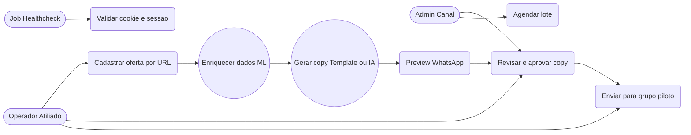
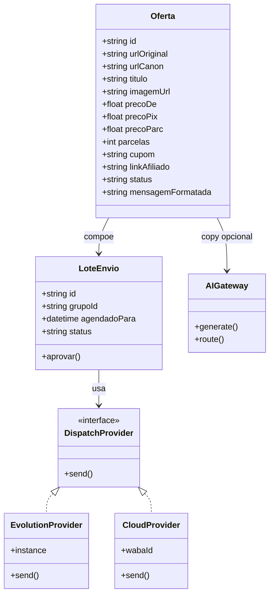
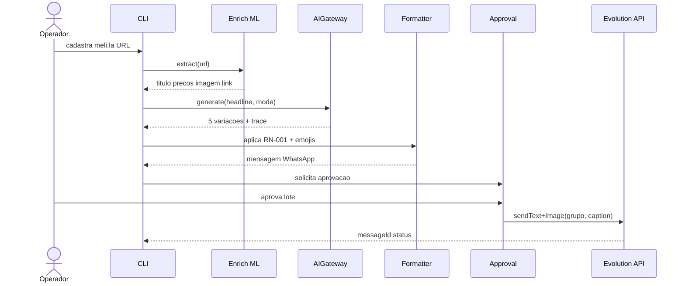
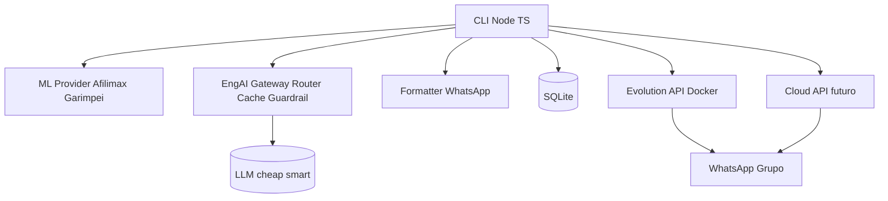

# 03 — Arquitetura e UML — autoMensagemWhats

> v0.1 | 2026-10-12 | Stack: Node 20 ESM + TS + SQLite + Evolution API + Provider ML + EngAI Gateway

## 1. Decisões (resumo, detalhe em `docs/04-ADRs/`)
- ADR-001: Evolution no MVP + interface para Cloud (híbrido).
- ADR-002: IA só via Gateway com approval, nunca direto.
- ADR-003: Afilimax/Garimpei self-host + fallback manual (cookie instável).

## 2. Casos de Uso (Mermaid)


Consistência: todo RF tem UC (RF-001→UC1, RF-002→UC5, RF-004/005→UC6, RF-007→UC7, RF-008→UC2, RF-009/010→UC3, RF-012→UC8).

## 3. Classes / ER (Mermaid)


SQLite tabelas: `ofertas`, `lotes`, `envios(messageId,status)`, `traces(modelo,tokens,custo,ms)`.

## 4. Sequência — fluxo principal (Mermaid)


## 5. Componentes / Deploy (texto + Mermaid)

Deploy MVP: 1 VPS Docker (app + Evolution + SQLite volume), `.env` para segredos, 1 IP BR dedicado por nº. Futuro: Cloud API sem mudar CLI (troca Provider).

## 6. Estrutura de pastas proposta
```
src/
  cli.ts
  oferta/service.ts schema.ts
  ml/provider.ts afilimax.ts garimpei.ts fallback.ts
  ai/gateway.ts tools/ prompts/
  wa/formatter.ts dispatch.ts evolution.ts cloud.ts
  store/sqlite.ts jobs/health.ts obs/stats.ts
docs/ image/ .env.example docker-compose.yml
```

## 7. Validação de consistência
- [x] Toda entidade tem dono (Oferta→OP, Lote→ADM, Trace→SISTEMA).
- [x] Todo RF rastreável (§7 SRS).
- [x] Nenhum envio sem approval (RN-006).
- [x] Números nunca mutados pela IA (RN-005 + Zod).
