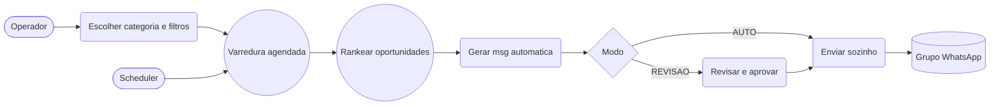
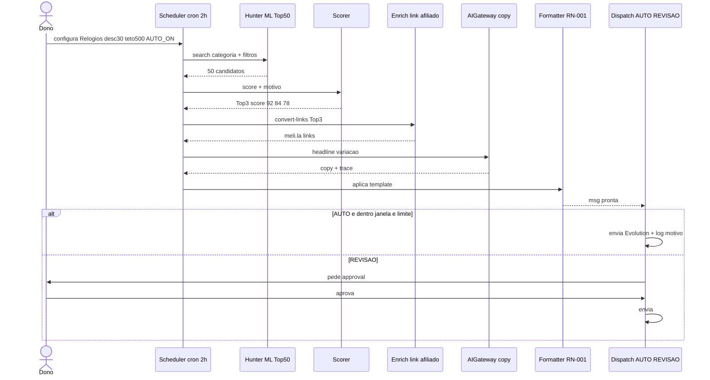
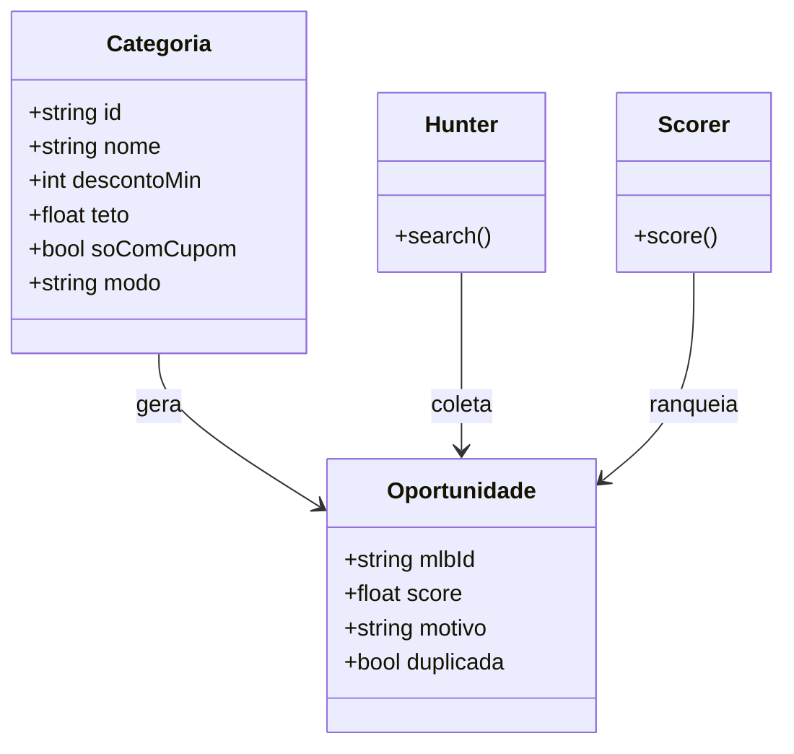

# 03 — Arquitetura e UML [v0.2 HUNTER]

> v0.2 | Scheduler + Hunter + Scorer. Formatter RN-001 e providers inalterados.

## 2. Casos de Uso v0.2

## 4. Sequência hunter (novo fluxo principal)

## Classes delta

Tabelas novas: `categorias`, `coletas(mlbId,preco,data)`, `oportunidades(score,motivo)`, `envios(hash,mlbId,data)` com índice anti-duplicidade 7d.

## ADR-004 (resumo)
Hunter self-host com cache 2h + histórico local; score explicável versionado; AUTO com kill-switch e default REVISÃO. Ver `docs/04-ADRs/ADR-004-hunter.md`.
